# Dolores AR

App turística con realidad aumentada para visitar Dolores Hidalgo, construida con TDD (ROJO, VERDE, REFACTOR).

## 1. Distancia (Haversine)

### ROJO: la prueba falla porque `distanciaMetros` todavía no existe en `geo.dart`.

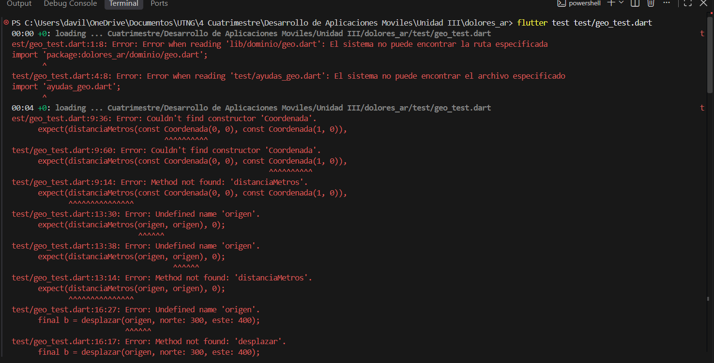

## 2. Rumbo y ángulos

### ROJO: la prueba falla porque faltan `rumboGrados`, `normalizar360`, `diferenciaAngular` y `suavizarAngulo`.

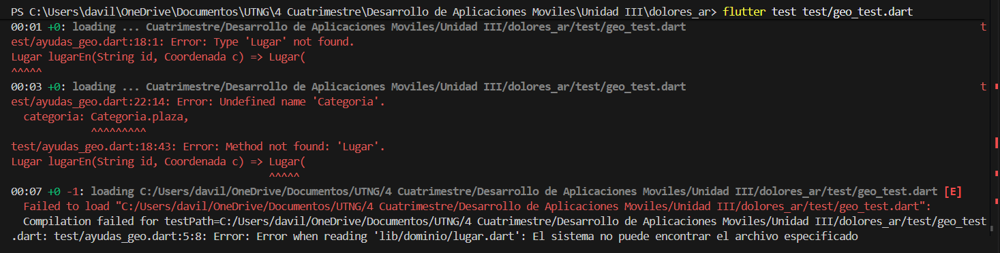

## 3. Campo de visión

### ROJO: la prueba falla porque faltan `posicionHorizontal`, `formatearDistancia` y `nombreCardinal`.

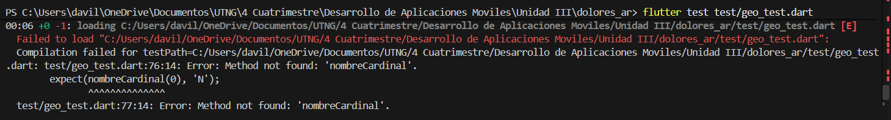

## 4. Motor de realidad aumentada

### ROJO: la prueba falla porque `motor_ar.dart` todavía no existe.

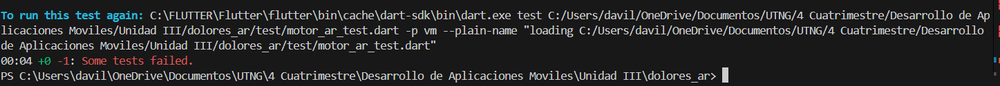

### VERDE: se implementa `calcularVisibles` y pasan las 9 pruebas del motor.

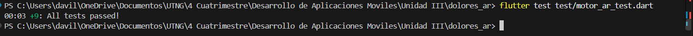

## 5. Pasaporte turístico

### ROJO: la prueba falla porque la clase `Pasaporte` todavía no existe.

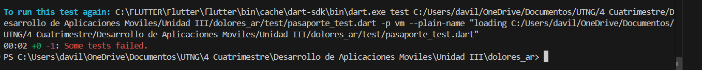

### VERDE: se implementa `Pasaporte` (sello a menos de 40 m, una sola vez) y pasan las 5 pruebas.

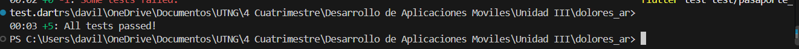

## 6. Fuentes de datos y ViewModel

### ROJO: la prueba falla porque faltan los contratos, las excepciones y `ArViewModel`.

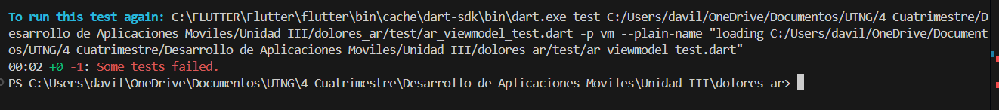

### VERDE: se implementa el ViewModel con fuentes falsas y pasan las 8 pruebas.

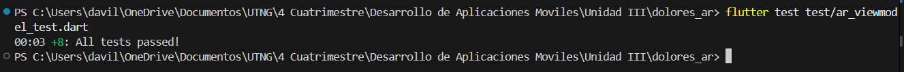

## 7. Resultado final

### VERDE: las 43 pruebas del proyecto pasan juntas con `flutter test`.

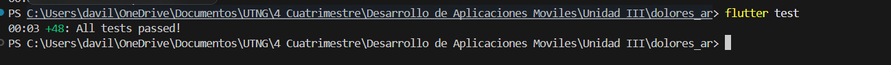

## 8.Resultado de las pantallas
### Explorar con GPS real
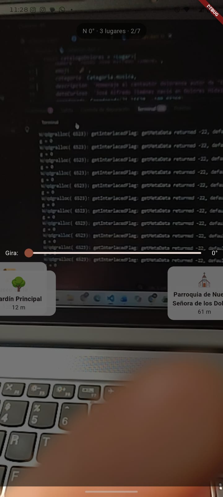

### Modo demo
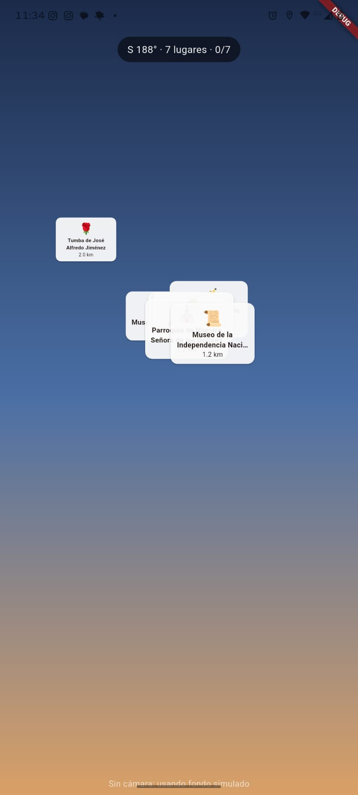
